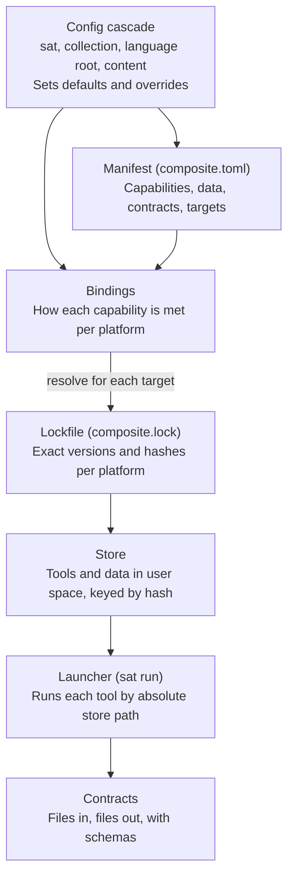

# ADR: Declarative Composite App Manifests for Cross-Platform SAT

## Status

| Field | Value |
| --- | --- |
| Status | Proposed |
| Version | 0.1.0 |
| ADR number | To assign; the earlier ADR-001 and its companion are no longer authoritative |
| Applies to | SAT core and its ingress and egress sub-apps |
| Related | Config cascade specification (draft), composite apps overview, SAT composite app sketch |

## Context

SAT needs one way to declare and run its tools that behaves the same on Linux, macOS and Windows, including older machines and low or intermittent bandwidth.

SAT is a composite app: an application assembled from independent, versioned tools installed side by side in user space. The core uses tools such as Python, Git and restic. Ingress and egress are separate sub-apps with their own manifests, such as `sat-ingress-markdown` (lint, normalise, slugify the H1, assign UUIDv7 identifiers, validate language tags) and `sat-egress-website-eleventy` (Dublin Core to Eleventy front matter).

SAT also depends on data, not only programs. Cached standards such as the IANA language subtag registry, the CommonMark and GFM specs, and the DCMI terms are inputs whose version changes results, just as a tool version does.

Two existing goals constrain the decision. The russian doll goal means a sat, collection or archive can be liberated from one SAT and moved into another, so whatever a node needs to run must travel with it. The config cascade (sat, collection, language root, content) is already SAT's mechanism for inheritance and override, and a second, unrelated configuration system would split the model.

## Decision drivers

- **Platform parity:** Linux, macOS and Windows, on x86-64 and ARM.
- **Offline installs:** once a cache or bundle is present, installing needs no network.
- **Reproducibility:** the same manifest and lock produce the same tools and data on every machine.
- **No lock-in:** any tool can be replaced without changing what an app declares.
- **Portable nodes:** a liberated sat, collection or archive carries everything it needs to run.
- **User space only:** no root or administrator rights, no system package manager.
- **Reviewable formats:** plain text a person can read and compare in a diff.
- **One configuration model:** toolchain settings follow the existing cascade.

## Decision

SAT adopts a declarative, layered model: each app declares what it needs, and a resolver decides how to provide it on each platform.



Only the manifest and bindings are written by people; the lock and store are generated, and the launcher runs only what the lock names.

1. **Manifest** (`composite.toml`). Human-written intent for one app or sub-app: capabilities with version ranges, data dependencies, input and output contracts, and target platforms. It holds no platform-specific paths or commands.
2. **Bindings.** A mapping from each capability to concrete implementations per platform, in priority order, for example a native binary, then a conda-forge package, then a Python package, then a container image. Bindings are shared between apps and can be overridden through the cascade.
3. **Lockfile** (`composite.lock`). Machine-written. For each target platform it records the exact version, source and SHA-256 hash of every tool and data asset, and it is committed beside the manifest.
4. **Store.** A content-addressed directory in user space, keyed by name, version, platform and hash, following the XDG base directory layout on Linux and its equivalents elsewhere <a id="cite-xdg"></a>([Bastian et al., 2021](#ref-xdg)). It holds tools and data alike, is shared between apps, and anything no lock references can be collected. The idea comes from the Nix store <a id="cite-dolstra"></a>([Dolstra, 2006](#ref-dolstra)).
5. **Launcher** (`sat run`). Reads the lock, builds the environment for one invocation and runs each tool by its absolute store path. It uses no shims, changes no global `PATH` and edits no shell profile.
6. **Contracts.** Each sub-app declares its input and output as file layouts plus schemas, in JSON Schema for metadata <a id="cite-jsonschema"></a>([JSON Schema, n.d.](#ref-jsonschema)). Sub-apps exchange files only.
7. **Cascade integration.** Manifests and bindings take part in the config cascade: SAT sets defaults, a collection may pin or override, and the nested SAT boundary is also the lock boundary.

Capabilities follow the provides and virtual package pattern from Debian <a id="cite-debian"></a>([Debian Project, n.d.](#ref-debian)): an app asks for `slugify`, not for a named program. Existing tools such as pixi <a id="cite-pixi"></a>([prefix.dev, n.d.](#ref-pixi)) may implement bindings, lock and store on some platforms, while the manifest stays SAT's own format so a backend can be swapped.

Where a step cannot be declared, an app may define a task. Tasks are written in Python or as declared tool invocations, never in a platform shell, and must be idempotent so a second run converges on the same result.

## Example

The three files below show one sub-app at each layer. Names, versions and the schema are illustrative, and hashes are elided.

The manifest declares intent only:

```toml
# sat-ingress-markdown/composite.toml
[app]
name = "sat-ingress-markdown"
version = "0.1.0"

[contract]
in = "schemas/commonmark-dc.json"
out = "schemas/sat-node.json"

[needs]
python = ">=3.14"
markdown-lint = "*"
markdown-normalize = { flavour = "gfm" }
slugify = { profile = "h1", normalization = "NFC" }
uuid = { version = 7 }

[data]
iana-language-subtags = "latest"
commonmark-spec = "0.31.2"

[platforms]
targets = ["linux-64", "linux-aarch64", "osx-arm64", "win-64"]
```

A binding maps a capability to implementations, first match wins:

```toml
# bindings/slugify.toml
[capability]
name = "slugify"
profiles = ["h1"]

[[provider]]
kind = "python-package"
package = "sat-slug"
platforms = ["*"]

[[provider]]
kind = "container"
image = "ghcr.io/steelcj/sat-slug"
platforms = ["linux-64"]
```

The lock records what was resolved, per platform:

```toml
# sat-ingress-markdown/composite.lock (excerpt)
[[tool]]
name = "python"
version = "3.14.0"
platform = "win-64"
source = "conda-forge"
sha256 = "..."

[[data]]
name = "iana-language-subtags"
version = "2026-10-15"
source = "https://www.iana.org/assignments/language-subtag-registry/language-subtag-registry"
sha256 = "..."
```

Note that `latest` in the manifest becomes a dated version in the lock, so an offline machine uses the copy that was locked.

## Cross-platform rules

SAT normalises at ingress and refuses ambiguous input, so the cascade and egress never see platform differences.

| Rule | Why | Enforced at |
| --- | --- | --- |
| File and directory names in Unicode NFC | macOS has historically stored names as NFD, so the same multilingual H1 can produce different bytes <a id="cite-unicode"></a>([Unicode Consortium, n.d.](#ref-unicode)) | Ingress |
| Slugs and paths lowercase, unique ignoring case | Windows and macOS file systems are case-insensitive by default, so `About.md` and `about.md` collide | Ingress and `sat init` |
| No reliance on symbolic links | Creating them on Windows needs developer mode or elevated rights | Spec, store, cascade |
| Forward-slash relative paths in manifests and locks | One spelling for every platform; the resolver converts | Manifest validation |
| LF line endings, UTF-8 without BOM | Avoids spurious diffs and parser errors | Markdown normaliser |
| No executable suffixes in manifests | The resolver adds `.exe` on Windows | Resolver |
| Tasks in Python or declared invocations, not shell | Bash and PowerShell scripts do not run on each other's platforms | Manifest validation |
| Language roots map to BCP 47 tags | `en-ca` maps to `en-CA` on every platform <a id="cite-rfc5646"></a>([Phillips & Davis, 2009](#ref-rfc5646)) | Ingress |
| Identifiers as `urn:uuid:` version 7 from Python | Avoids depending on the host's `uuidgen` <a id="cite-rfc9562"></a>([Davis et al., 2024](#ref-rfc9562)) | Ingress |

## Options considered

No existing system meets every driver, so SAT borrows ideas from several and keeps the right to use some as backends.

| Option | What it offers | Why it is not the model | Role in SAT |
| --- | --- | --- | --- |
| Nix or Guix as the base | Content-addressed store, strong reproducibility, rollback | No native Windows; steep learning curve for the people Vishpala serves | Source of the store and lock ideas |
| pixi with conda-forge | Multi-platform lockfile, user space, Linux, macOS and Windows | Package-oriented; no notion of capabilities, data assets or contracts | Candidate backend for bindings, lock and store |
| mise or asdf | Simple per-project tool versions in user space | Shims and `PATH` ordering are fragile on Windows and leak between apps | Possible backend for a few tools |
| Containers (OCI, devcontainers, Flatpak) | Strong isolation | Large downloads, weak on older hardware, awkward on Windows and macOS | Last-resort binding only |
| Imperative install scripts | Maximum flexibility | Drift between machines; shell-specific; not reproducible | Idempotent tasks only |
| WebAssembly components | One portable binary for every platform | Ecosystem not yet ready for SAT's tools | Watch for small pure tools such as slugifiers |

## Consequences

The model makes SAT portable and replaceable at the cost of owning a resolver and a binding catalogue.

Positive:

- A liberated node carries its manifest and lock, so it runs in any SAT that honours the contracts.
- Tools and standards can be swapped by changing a binding, not every app.
- A lock plus a filled store can be exported as a bundle for machines with little or no bandwidth.
- Nothing outside user space is touched, so installs need no administrator rights.

Negative:

- SAT must build and maintain a resolver, a launcher and a catalogue of bindings.
- Locking for four platforms means resolving on, or for, each of them.
- Some tools have no Windows build and will fall back to containers or be unavailable there.

Follow-up work:

- [ ] Write the manifest, binding and lock schemas in JSON Schema
- [ ] Add a toolchain section to the config cascade specification
- [ ] Prototype `sat run` with one backend
- [ ] Define bundle export and import for offline machines

## Open questions

- [ ] May a sub-app pin a different Python than SAT core, or must versions agree within one SAT?
- [ ] Which backend comes first: pixi, mise, or SAT's own fetcher?
- [ ] One lock per app, or one lock per SAT instance with a section per app?
- [ ] Where does the store live on Windows and macOS, and is it shared between SAT instances on one machine?
- [ ] Where are bindings published and versioned, in sat-doc-automa or a repository of their own?
- [ ] Are hashes enough, or do locks and bundles also need signatures?
- [ ] Which ADR number does this take, and does it supersede ADR-001?

## References

<a id="ref-xdg"></a>
Bastian, W., Lortie, R., Poettering, L., & Löthberg, J. (2021). *XDG base directory specification* (Version 0.8). freedesktop.org. https://specifications.freedesktop.org/basedir-spec/latest/
[Return to citation](#cite-xdg)

<a id="ref-rfc9562"></a>
Davis, K., Peabody, B., & Leach, P. (2024). *Universally unique identifiers (UUIDs)* (RFC 9562). RFC Editor. https://doi.org/10.17487/RFC9562
[Return to citation](#cite-rfc9562)

<a id="ref-debian"></a>
Debian Project. (n.d.). Virtual packages: Provides. In *Debian policy manual*. https://www.debian.org/doc/debian-policy/ch-relationships.html
[Return to citation](#cite-debian)

<a id="ref-dolstra"></a>
Dolstra, E. (2006). *The purely functional software deployment model* [Doctoral dissertation, Utrecht University]. https://edolstra.github.io/pubs/phd-thesis.pdf
[Return to citation](#cite-dolstra)

<a id="ref-jsonschema"></a>
JSON Schema. (n.d.). *JSON Schema specification*. https://json-schema.org/specification
[Return to citation](#cite-jsonschema)

<a id="ref-rfc5646"></a>
Phillips, A., & Davis, M. (2009). *Tags for identifying languages* (RFC 5646, BCP 47). RFC Editor. https://doi.org/10.17487/RFC5646
[Return to citation](#cite-rfc5646)

<a id="ref-pixi"></a>
prefix.dev. (n.d.). *Pixi documentation*. https://pixi.sh/latest/
[Return to citation](#cite-pixi)

<a id="ref-unicode"></a>
Unicode Consortium. (n.d.). *Unicode Standard Annex #15: Unicode normalization forms*. https://www.unicode.org/reports/tr15/
[Return to citation](#cite-unicode)
