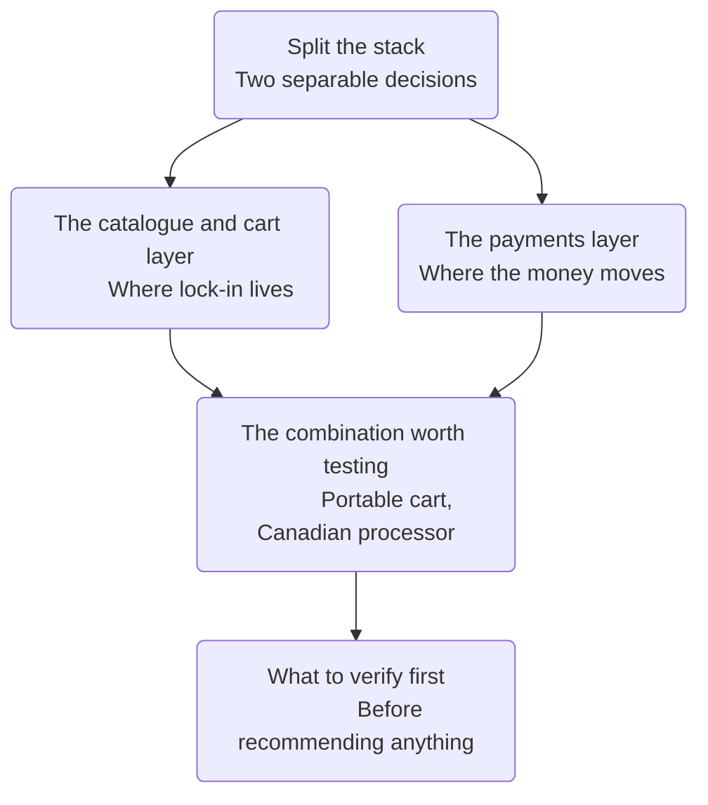

# Canadian and Quebec Owned Cart and Payment Options for Static Client Sites

Version: 0.1.0
Status: Draft
Style Guide: style-guide--versioned-documents-in-unrendered-markdown

## Abstract

The Snipcart and Ecwid evaluations both concluded that neither product gives a Canadian merchant a Canadian owned billing relationship, and both bill in United States dollars. This document surveys what is actually available under Canadian or Quebec ownership. Its central finding is that the question should be split in two: an embeddable cart holds the catalogue and runs the checkout flow, and a payment processor moves the money, and these are separable decisions with very different ownership landscapes. Canadian ownership is readily available at the payments layer and nearly absent at the cart layer. Since lock-in lives in the catalogue and the money lives in payments, the configuration that best satisfies the Vishpala position pairs a cart that leaves the catalogue in the client's own files with a Canadian owned processor behind it.

## Sources and Acknowledgements

The evaluation vocabulary used here, including content endurance, exit cost, take rate and pricing asymmetry, is drawn from [Steel (2026)](#apa-uc-metrics-reference). Product facts come from vendor documentation and pricing pages where available, and from secondary reviews where not, with the distinction marked at each claim. No hands-on testing was performed for this survey.

## Map of the decision

## Split the stack

A cart product does two jobs that are usually sold together and do not have to be bought together. It holds the catalogue and runs the checkout flow, and it moves the money.

Separating them matters because the two jobs carry different risks. The catalogue layer is where lock-in lives, because whoever holds the product data holds the client's ability to leave. The payments layer is where the money and the merchant's banking relationship live, and it is also where most of the recurring cost sits once a store has any volume at all.

The ownership landscape for the two layers is not the same. Canadian ownership is genuinely available for payments, with several independent providers and published rates. At the cart layer, the Canadian owned field narrows to two names, both of which hold the catalogue on their own servers.

[Return to the chart](#nav-chart)

## The catalogue and cart layer

Two Canadian owned products embed commerce into a site the merchant already has.

### Shopify Buy Button

Shopify is headquartered in Ottawa and publicly listed. Its Starter plan, at five dollars monthly, is not a storefront: it exists to add a buy button or checkout link to an existing website, social channel or messaging app, through the Buy Button sales channel, with checkout handled on Shopify's own hosted checkout ([Shopify, n.d.](#apa-shopify-pricing-reference)). Billing is available in Canadian dollars and Shopify Payments is available to Canadian merchants.

Two reservations.

Secondary sources put the Starter plan's online card rate at five percent plus thirty cents per transaction ([Startup Launch Page, 2026](#apa-startuplaunchpage-reference)). If that figure is accurate, it is substantially above a typical processor rate and would overwhelm the low subscription price for any merchant with real volume. It must be confirmed against Shopify's own published rate card before being quoted to a client.

More fundamentally, the catalogue is authored in the Shopify admin and stored on Shopify's infrastructure. Under the content endurance question in the metrics, this is a container rather than an enhancement layer, so the client's product data leaves with the vendor ([Steel, 2026](#apa-uc-metrics-reference)). It fails the same test Ecwid fails, for the same reason.

### Ecwid, now Lightspeed Ecom

Ecwid was acquired by Lightspeed Commerce, a Montreal founded public company, with the transaction closing on 1 October 2021 ([Lightspeed Commerce, 2021](#apa-lightspeed-closing-reference)), and is being renamed Lightspeed Ecom in the E-Series line ([Ecwid, n.d.-a](#apa-ecwid-lightspeed-reference)). It is covered in full in the separate Ecwid evaluation and is included here only for completeness, and to record the finding that its published billing currencies do not include the Canadian dollar ([Ecwid, n.d.-b](#apa-ecwid-pricing-reference)).

[Return to the chart](#nav-chart)

## The payments layer

This is where Canadian ownership is actually obtainable.

### Helcim

Helcim is a payment processor based in Calgary, offering interchange-plus pricing to all merchants rather than only to large accounts, with no monthly fee, no long-term contract and no cancellation fee ([NerdWallet, 2026](#apa-nerdwallet-helcim-reference)). Its product range includes online checkout, payment pages, payment links, invoicing, recurring payments, a catalogue, an online store builder, and developer APIs ([Crunchbase, n.d.](#apa-crunchbase-helcim-reference)).

Two things make it interesting for this practice beyond its ownership. Its rates are published rather than negotiated, which scores directly against the pricing asymmetry proxy, where opacity itself signals who holds the leverage regardless of whether current prices are reasonable ([Steel, 2026](#apa-uc-metrics-reference)). And its checkout form can be added to a site the merchant already has, which places it in the same architectural position as the direct payment link option considered in the Snipcart evaluation, but under Canadian ownership.

It is not a cart. It will not handle a multi-item basket with shipping rules, tax rules and inventory across a catalogue. For a merchant selling a small number of items, that may not matter.

### Moneris and Nuvei

Two further names belong on the radar, both stated here from general knowledge and neither verified in this pass. Moneris is a Toronto based processor understood to be a joint venture of two Canadian banks, which would make it about as domestically anchored as payments get, though it is heavier and more traditional than Helcim for a small shop. Nuvei is Montreal headquartered but is understood to have been taken private by a United States investor, and is oriented toward enterprise rather than small business.

Neither claim should be repeated to a client until checked. They are recorded here so the next pass knows where to look.

[Return to the chart](#nav-chart)

## The combination worth testing

Snipcart supports several payment gateways and additionally documents a custom payment gateway interface, alongside its wider API and webhook surface ([Snipcart, n.d.-a](#apa-snipcart-releases-reference)). Its products are declared as markup attributes in pages the merchant already controls ([Snipcart, n.d.-b](#apa-snipcart-about-reference)), which is why it scored strongly on content endurance while the Canadian owned cart products did not.

That combination is the configuration that actually satisfies the position this practice takes publicly:

- The catalogue lives in the client's own content archive and is rendered into their own pages, so it survives the disappearance of any vendor.
- The money moves through a Canadian owned processor, in Canadian dollars, into a Canadian bank account.
- No single vendor holds both the content and the payment relationship, which is a meaningful reduction in exit cost even though neither individual component is self-hostable.

No public Snipcart integration for a Canadian processor appears to exist. Building one against the custom payment gateway interface would be a small, well scoped open source project sitting precisely at the intersection of this practice's stack, its stated values and its target market, and it would demonstrate the position more convincingly than any amount of website copy.

Two caveats before treating that as a plan. The Helcim API must actually support the operations the custom gateway interface requires, which has not been checked. And Snipcart's existing gateway integrations may already settle Canadian dollars into a Canadian bank account, in which case the merchant is already paid domestically and only the subscription is foreign, which reduces the urgency considerably.

[Return to the chart](#nav-chart)

## What to verify first

None of the following is settled, and each is cheap to resolve.

- Shopify's actual Starter plan card rate, from Shopify's own rate card rather than a secondary review.
- Whether Snipcart's Stripe integration settles Canadian dollars into a Canadian bank account, since this determines whether the Canadian ownership question is a payments problem or only a subscription problem.
- Helcim's API surface against Snipcart's custom payment gateway requirements.
- Moneris and Nuvei current ownership, from filings or company statements.
- Whether any of the Canadian owned options publish an accessibility conformance report, since none of the products evaluated so far do.

[Return to the chart](#nav-chart)

## Summary

| Product | Base | Ownership | Merchant billing | Layer | Catalogue location |
|---------|------|-----------|------------------|-------|--------------------|
| Shopify Buy Button | Ottawa | Canadian, public | CAD | Cart | Vendor |
| Ecwid, Lightspeed Ecom | United States | Canadian, public | USD | Cart | Vendor |
| Helcim | Calgary | Canadian, independent | CAD | Payments | Not applicable |
| Moneris | Toronto | Canadian, unverified | CAD | Payments | Not applicable |
| Snipcart | Quebec City | United States | USD | Cart | Client's own files |

The table makes the trade explicit. Every option that keeps the catalogue in the client's files is foreign owned, and every Canadian owned cart keeps the catalogue on its own servers. The two-layer approach is the only configuration that gets both.

[Return to the chart](#nav-chart)

## License

This document, *Canadian and Quebec Owned Cart and Payment Options for Static Client Sites*, by **Christopher Steel**, with AI assistance from **Claude Opus 5 (Anthropic)**, is licensed under the [GNU Affero General Public License v3.0 or later](https://www.gnu.org/licenses/agpl-3.0.html).

## Resources

### Evaluation framework

- [Universal Cake Evaluation Metrics](#apa-uc-metrics-reference)

### Cart platforms

- [Shopify pricing and plans](#apa-shopify-pricing-reference)
- [Shopify Starter plan analysis](#apa-startuplaunchpage-reference)
- [Snipcart release notes](#apa-snipcart-releases-reference)
- [Snipcart company background](#apa-snipcart-about-reference)
- [Ecwid transition to Lightspeed](#apa-ecwid-lightspeed-reference)
- [Ecwid plan pricing changes](#apa-ecwid-pricing-reference)
- [Lightspeed acquisition of Ecwid](#apa-lightspeed-closing-reference)

### Payment processors

- [Helcim product overview](#apa-crunchbase-helcim-reference)
- [Helcim independent review](#apa-nerdwallet-helcim-reference)

## References

Crunchbase. (n.d.). *Helcim company profile*. Retrieved August 31, 2026, from https://www.crunchbase.com/organization/helcim
[Return to citation](#apa-crunchbase-helcim-citation)

Ecwid. (n.d.-a). *Ecwid is now Lightspeed*. Ecwid Help Center. Retrieved August 31, 2026, from https://support.ecwid.com/hc/en-us/articles/5582039267996-Ecwid-is-now-Lightspeed
[Return to citation](#apa-ecwid-lightspeed-citation)

Ecwid. (n.d.-b). *Changes to the Ecwid plan pricing after March 2, 2026*. Ecwid Help Center. Retrieved August 31, 2026, from https://support.ecwid.com/hc/en-us/articles/25122701806108-Changes-to-the-Ecwid-plan-pricing-after-March-2-2026
[Return to citation](#apa-ecwid-pricing-citation)

Lightspeed Commerce. (2021, October 1). *Lightspeed announces closing of acquisition of Ecwid*. PR Newswire. https://www.prnewswire.com/news-releases/lightspeed-announces-closing-of-acquisition-of-ecwid-301389946.html
[Return to citation](#apa-lightspeed-closing-citation)

NerdWallet. (2026). *Helcim review: Features, pricing, alternatives*. Retrieved August 31, 2026, from https://www.nerdwallet.com/business/software/reviews/helcim
[Return to citation](#apa-nerdwallet-helcim-citation)

Shopify. (n.d.). *Shopify pricing: Find the right plan for your business*. Retrieved August 31, 2026, from https://www.shopify.com/pricing
[Return to citation](#apa-shopify-pricing-citation)

Snipcart. (n.d.-a). *Release notes*. Snipcart Documentation. Retrieved August 31, 2026, from https://docs.snipcart.com/v3/release-notes
[Return to citation](#apa-snipcart-releases-citation)

Snipcart. (n.d.-b). *About*. Retrieved August 31, 2026, from https://snipcart.com/about
[Return to citation](#apa-snipcart-about-citation)

Startup Launch Page. (2026). *Shopify pricing 2026: Every plan, fee, and hidden cost explained*. Retrieved August 31, 2026, from https://www.startuplaunchpage.com/blog/shopify-pricing-2026
[Return to citation](#apa-startuplaunchpage-citation)

Steel, C. (2026). *Universal Cake evaluation metrics* (Version 0.5.1). UniversalCake.
[Return to citation](#apa-uc-metrics-citation)

## Changelog

| Version | Status | Notes |
|---------|--------|-------|
| 0.1.0 | Draft, version provisional | Initial survey following the Snipcart and Ecwid evaluations; introduces the two-layer framing separating the catalogue and cart layer from the payments layer; records Shopify Buy Button and Ecwid as the only Canadian owned cart options and both as containers; records Helcim as the strongest Canadian owned payments option; proposes a Snipcart plus Canadian processor combination and a possible open source custom gateway; flags Moneris and Nuvei ownership and Shopify's Starter card rate as unverified |
