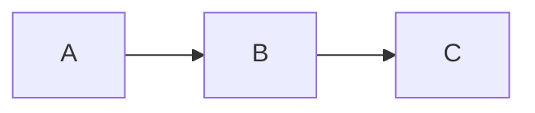

# GitHub Markdown (GFM) is GitHub's implementation of Markdown

GitHub Markdown is GitHub's implementation of **Markdown**, a lightweight markup language originally created by John Gruber and Aaron Swartz. GitHub extends the original syntax with **GitHub Flavored Markdown (GFM)**, adding features that make it suitable for software documentation, issue tracking, knowledge bases, and static websites.

Front matter, by contrast, is **not part of Markdown**. It is a convention adopted by many static site generators and documentation systems to embed metadata at the beginning of a Markdown file.

------

# GitHub Flavored Markdown (GFM)

GitHub Flavored Markdown extends CommonMark with additional features.

## Basic Syntax

```markdown
# Heading 1
## Heading 2
### Heading 3

This is a paragraph.

**Bold**

*Italic*

***Bold Italic***

`inline code`

> Blockquote

- Item 1
- Item 2

1. First
2. Second

[OpenAI](https://openai.com)


```

------

## Code Blocks

GitHub supports fenced code blocks with syntax highlighting.

~~~markdown
```python
def hello():
    print("Hello World")
```
~~~

Produces

```python
def hello():
    print("Hello World")
```

GitHub supports hundreds of language identifiers.

Examples include:

```text
bash
python
yaml
json
javascript
typescript
go
rust
html
css
sql
```

------

## Tables

```markdown
| Name | Description |
|------|-------------|
| Git | Version Control |
| Markdown | Documentation |
```

Produces

| Name     | Description     |
| -------- | --------------- |
| Git      | Version Control |
| Markdown | Documentation   |

------

## Task Lists

```markdown
- [x] Install Git
- [x] Clone repository
- [ ] Deploy site
```

Produces

-  Install Git
-  Clone repository
-  Deploy site

------

## Alerts (GitHub Extensions)

GitHub supports callout blocks.

```markdown
> [!NOTE]
> This is a note.

> [!TIP]
> Helpful advice.

> [!WARNING]
> Proceed carefully.
```

------

## Footnotes

```markdown
Markdown is easy.[^1]

[^1]: A footnote.
```

------

## Strikethrough

```markdown
~~obsolete~~
```

Produces

~~obsolete~~

------

## Emoji

```markdown
:rocket:
```

Produces

:rocket:

------

## Automatic Links

```markdown
https://github.com
```

GitHub automatically converts URLs into hyperlinks.

------

## Mermaid Diagrams

GitHub renders Mermaid diagrams.

~~~markdown

~~~

------

## Mathematical Expressions

GitHub now supports LaTeX math.

```markdown
$$
E = mc^2
$$
```

------

# Front Matter

Front matter is metadata placed before the Markdown content.

It is enclosed by delimiters.

## YAML Front Matter

Most common.

```yaml
---
title: GitHub Markdown Guide
author: Christopher Steel
date: 2026-08-05
description: Introduction to Markdown
tags:
  - markdown
  - github
categories:
  - documentation
draft: false
---
```

Everything after the closing `---` is Markdown.

------

## TOML Front Matter

Used by some tools like Hugo.

```toml
+++
title = "GitHub Markdown Guide"
author = "Christopher Steel"
draft = false
+++
```

------

## JSON Front Matter

Less common.

```json
{
  "title": "GitHub Markdown Guide",
  "draft": false
}
```

------

# Common Front Matter Fields

There is **no universal standard**. Different systems recognize different fields.

| Field       | Purpose               |
| ----------- | --------------------- |
| title       | Document title        |
| description | Summary               |
| author      | Author                |
| date        | Publication date      |
| lastmod     | Last modified         |
| tags        | Keywords              |
| categories  | Classification        |
| slug        | URL slug              |
| draft       | Hide from publication |
| weight      | Navigation order      |
| aliases     | Redirect URLs         |
| menu        | Navigation placement  |
| image       | Social sharing image  |
| lang        | Language              |
| canonical   | Canonical URL         |

------

# Static Site Generators

Many generators read front matter.

| System          | Front Matter            |
| --------------- | ----------------------- |
| Jekyll          | YAML                    |
| Hugo            | YAML, TOML, JSON        |
| MkDocs Material | Via plugins or metadata |
| Docusaurus      | YAML                    |
| Eleventy        | YAML, JSON, JS          |
| Astro           | YAML                    |
| Gatsby          | YAML                    |
| Quartz          | YAML                    |

GitHub itself ignores most front matter when rendering Markdown files directly in repositories, but projects built with tools like GitHub Pages (using Jekyll) can use it during site generation.

------

# Front Matter vs Markdown

```text
----------------------------
Front Matter (metadata)
----------------------------
title
author
date
tags
draft
description
----------------------------
Markdown Content
----------------------------
# Heading

Paragraphs

Lists

Images

Tables

Code

Mermaid
```

The Markdown parser ignores the front matter after it has been extracted by the site generator.

------

# Relationship to Metadata Standards

Front matter often serves as a lightweight metadata layer. Many fields can be mapped to formal metadata standards:

| Front Matter | Dublin Core                             |
| ------------ | --------------------------------------- |
| title        | `dc:title`                              |
| author       | `dc:creator`                            |
| description  | `dc:description`                        |
| date         | `dcterms:created` or `dcterms:modified` |
| tags         | `dc:subject`                            |
| language     | `dc:language`                           |
| rights       | `dc:rights`                             |
| publisher    | `dc:publisher`                          |
| identifier   | `dc:identifier`                         |

For projects concerned with long-term interoperability (such as digital libraries, archives, or knowledge management systems), this mapping allows front matter to act as a bridge between simple authoring workflows and richer metadata ecosystems.

------

# Best Practices

- Keep metadata in front matter and content in Markdown.
- Use lowercase, machine-friendly keys (`lastmod` rather than `Last Modified`).
- Store dates in ISO 8601 format (`2026-08-05` or `2026-08-05T14:30:00Z`).
- Use arrays for tags and categories.
- Keep metadata consistent across all documents.
- Avoid embedding information in filenames that belongs in metadata.
- If you're building a multilingual documentation site, include fields such as `lang`, `translationKey`, or equivalent to associate translated versions.

------

# Summary

GitHub Flavored Markdown (GFM) extends standard Markdown with features like tables, task lists, syntax-highlighted code blocks, Mermaid diagrams, alerts, footnotes, and math, making it well suited for technical documentation.

Front matter is a separate metadata convention placed at the beginning of a Markdown file. While GitHub's Markdown renderer largely ignores it, static site generators such as Jekyll, Hugo, MkDocs, Docusaurus, and Eleventy use front matter to control page metadata, navigation, publication settings, and SEO. For documentation projects, front matter provides a clean separation between **document content** and **document metadata**, and it can be aligned with standards such as Dublin Core to improve portability and interoperability.